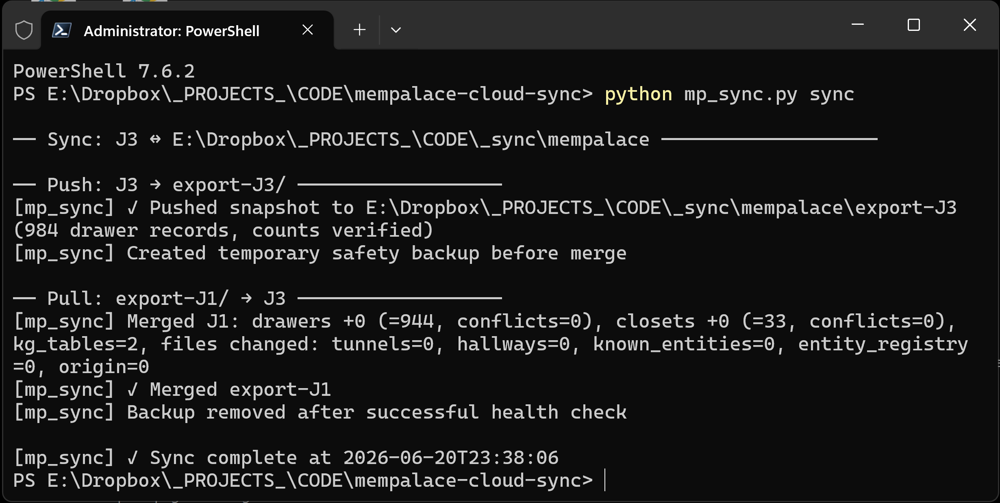

# MemPalace Cloud Sync

Version 1.3.0

Bidirectional sync for [MemPalace](https://github.com/MemPalace/mempalace) across multiple machines, via your preferred Cloud Storage provider (Dropbox, Google Drive, OneDrive etc.).

> Don't have MemPalace yet? Here's a [guide on how to set it up](https://www.shambix.com/ai-persistent-memory-mempalace-guide-claude-lmstudio-cursor-vscode/) and connect it to your favorite IDEs and AI tools.



---

## How it works

MemPalace stores memories in ChromaDB — a binary HNSW index plus SQLite. Syncing raw DB files via Dropbox/OneDrive is unsafe because non-atomic transfers can silently corrupt the index.

This tool does **not** sync live palace DB files. Instead, each `push` writes a machine-local **snapshot export** into the shared folder, and each `pull` merges snapshots from other machines into your local palace. **Every machine converges to the union of all memories.**

Each machine writes only to its own `export-{name}/` subfolder — no two machines ever touch the same file, which prevents cloud storage conflict copies.

Snapshot contents per machine:

- Chroma collections exported to JSONL (`drawers`, `closets`)
- Supporting state files (`knowledge_graph.sqlite3`, `tunnels.json`, `hallways.json`, `known_entities.json`, `entity_registry.json`, origin metadata)
- `manifest.json` with record counts and export warnings

Merge behavior: identical records are skipped, new records are inserted, ID collisions with different content get conflict-safe IDs, JSON state files merge additively, knowledge graph uses `INSERT OR IGNORE`.

### Shared folder layout

```
E:\Dropbox\mempalace-sync\
├── export-home-pc\
│   ├── .meta.json              (last push/pull timestamps for this machine)
│   ├── sync.log                (appending terse log, written on every `sync` run)
│   ├── sync_last_run.log       (last run detail, overwritten each run, written on every `sync` run)
│   └── snapshot\
│       ├── manifest.json
│       ├── collections\
│       │   ├── drawers.jsonl
│       │   └── closets.jsonl
│       └── files\
│           ├── knowledge_graph.sqlite3
│           ├── tunnels.json
│           ├── hallways.json
│           ├── known_entities.json
│           ├── entity_registry.json
│           └── origin.json
└── export-work-laptop\
    └── ...
```

`.jsonl` files are plain text (one JSON object per line). No files are written to the sync root — each machine owns its `export-{name}/` dir exclusively.

### Pull safety

Before merge, `pull` backs up all local palace state it may mutate. After merge it runs health checks (collection open/count, optional HNSW divergence probe, SQLite `PRAGMA quick_check`). If anything fails, local state is restored from backup automatically.

### Palace lock contention

The palace uses a single-writer lock, so `pull` can collide with a running mempalace MCP server (Claude Code, Cursor, VS Code) that's mid-write. A live writer only holds the lock for the duration of one write call, so `pull` retries automatically — up to 10 attempts, 5s apart (~50s total) — before giving up.

If the lock is still held after that, it's no longer a normal brief write — most likely a wedged/orphaned MCP server process that never released it. Pass `--break-stale-lock` to `pull`/`sync` to have `mp_sync` verify the holder's command line actually names a mempalace MCP server, then stop it and retry once more. It refuses to touch any process that doesn't match. This is opt-in (not the default) because it can't distinguish "wedged" from "an unusually long legitimate write" — only that the wait ran out.

---

## Requirements

- Python 3.13+
- MemPalace 3.3.5+ installed on the machine, either as a Python package (`pip`) or CLI tool (`uv tool install mempalace`)
- A shared folder all machines can access (same Dropbox/OneDrive/etc. folder, synced offline on all machines)

---

## Setup — once per machine

1. Clone or [download](https://github.com/Jany-M/mempalace-cloud-sync/archive/refs/heads/main.zip) this repo on each machine (doesn't need to be in the shared folder).

2. Create a subfolder in your cloud storage for sync exports (e.g. `E:\Dropbox\mempalace-sync`), let it sync to all machines, and make sure it's **always available offline**.

3. Run interactive setup on each machine:

```
python mp_sync.py setup
```

| Field | Description | Example |
|---|---|---|
| `sync_folder` | Shared cloud folder for `export-*` snapshots | `E:\Dropbox\mempalace-sync` |
| `palace_path` | Local MemPalace palace directory | `C:\Users\you\.mempalace\palace` |
| `machine_name` | Unique short label for this machine | `home-pc` |

Config is saved to `~/.mempalace/mp_sync_config.json`. At the end of setup, note the `Hook launcher` line — it tells you the exact command to use in hooks below (differs between pip and uv installs).

Important:

- `sync_folder` must point to the same shared cloud folder on all machines, even if the local path differs per machine
- `machine_name` must be unique per machine
- Setup accepts a fresh/empty palace path and will create the directory if it does not exist yet

### Fresh machine bootstrap

If machine 2 has no palace yet, no pre-initialization needed:

1. On machine 1 (existing memories): run `push`
2. On machine 2 (empty palace): run `pull`
3. Then use `sync` normally on both machines

If setup cannot detect a usable MemPalace runtime, install or repair MemPalace first:
- Getting started: https://mempalaceofficial.com/guide/getting-started.html
- Repository: https://github.com/MemPalace/mempalace

---

## Manual sync

```bash
# Full sync (push + pull) — prints progress to terminal
python mp_sync.py sync

# Full sync — logs are always written to export-{machine}/, --quiet just silences the console
python mp_sync.py sync --quiet

# Full sync — also auto-recovers from a wedged palace lock (see "Palace lock contention")
python mp_sync.py sync --quiet --break-stale-lock

# Run separately
python mp_sync.py push   # write this machine's snapshot to shared folder
python mp_sync.py pull   # merge other machines' snapshots into local palace

# Check state (machine folders, record counts, last push/pull times)
python mp_sync.py status

# Remove accumulated .drift-* HNSW quarantine dirs (push does this automatically)
python mp_sync.py clean
```

---

## Automation

> **Hook command:** Use the exact command printed by `python mp_sync.py setup` under `Hook launcher:`. If setup printed a `uv run --with mempalace ...` command, use that everywhere in place of the `python ...` examples below.

> **Windows path note:** Use forward slashes (`/`) in hook commands, not backslashes. Claude Code, Cursor, and VS Code run hooks through a POSIX shell that strips `\` from Windows paths.

### Claude Code hooks

Edit `~/.claude/settings.json`:

```json
{
  "hooks": {
    "SessionStart": [
      {
        "matcher": "",
        "hooks": [{ "type": "command", "command": "python C:/PATH/TO/THIS/REPO/mempalace-cloud-sync/mp_sync.py sync --quiet" }]
      }
    ],
    "SessionEnd": [
      {
        "matcher": "",
        "hooks": [{ "type": "command", "command": "python C:/PATH/TO/THIS/REPO/mempalace-cloud-sync/mp_sync.py sync --quiet" }]
      }
    ]
  }
}
```

Notes:
- `SessionEnd` only fires on a clean exit (`/exit`, `Ctrl+D`) and **does not exist in Claude Code CLI**.
- For CLI use, pick one: a `Stop` hook as fallback (token-free, runs after each agent response), `/schedule` for periodic syncs (uses tokens), or an OS task scheduler (see below).
- **Claude Cowork** doesn't have hooks — use its Scheduled Tasks feature or an OS task scheduler.

### Cursor hooks

Use `.cursor/hooks.json` (project) or `~/.cursor/hooks.json` (user):

```json
{
  "version": 1,
  "hooks": {
    "sessionStart": [{ "command": "python C:/PATH/TO/THIS/REPO/mempalace-cloud-sync/mp_sync.py pull --quiet" }],
    "sessionEnd":   [{ "command": "python C:/PATH/TO/THIS/REPO/mempalace-cloud-sync/mp_sync.py push --quiet" }]
  }
}
```

Note: Cursor also supports a `stop` hook, but that is a different event from `sessionEnd`.

### VS Code hooks

```json
{
  "hooks": {
    "SessionStart": [{ "type": "command", "command": "python C:/PATH/TO/THIS/REPO/mempalace-cloud-sync/mp_sync.py pull --quiet" }],
    "Stop":         [{ "type": "command", "command": "python C:/PATH/TO/THIS/REPO/mempalace-cloud-sync/mp_sync.py push --quiet" }]
  }
}
```

VS Code does not use `SessionEnd` — `Stop` is the end-of-agent-session hook. VS Code reads Claude-style hook files (`.claude/settings.json`, `~/.claude/settings.json`) or workspace hook files (`.github/hooks/mempalace-cloud-sync.json`).

### Provider references

- Claude Code hooks: <https://code.claude.com/docs/en/hooks>
- Claude Desktop Scheduled Tasks: <https://code.claude.com/docs/en/desktop-scheduled-tasks>
- Cursor hooks: <https://cursor.com/docs/hooks>
- VS Code hooks: <https://code.visualstudio.com/docs/agent-customization/hooks>

### Windows Task Scheduler

**Auto-pull on login:** Open Task Scheduler → Create Basic Task → Trigger: When I log on → Action: Start a program.
- Program: `python` (or `uv` if using uv)
- Arguments: `C:/PATH/TO/THIS/REPO/mempalace-cloud-sync/mp_sync.py pull --quiet` (or `run --with mempalace python C:/PATH/TO/THIS/REPO/mempalace-cloud-sync/mp_sync.py pull --quiet` for uv)

**Auto-sync every 60 minutes** (run in PowerShell):

```
schtasks /create /tn "MemPalace Sync" /tr "cmd /c python C:/PATH/TO/THIS/REPO/mempalace-cloud-sync/mp_sync.py sync --break-stale-lock & timeout /t 10 & if errorlevel 1 pause" /sc minute /mo 60 /f
```

- `--break-stale-lock` is recommended for an unattended task — otherwise a wedged MCP server (see "Palace lock contention") permanently blocks every future run until you notice and clear it by hand.
- No `--quiet`, so the console window shows sync progress. `timeout /t 10` closes that window 10s after the script finishes; pressing any key during those 10s cancels the close and holds the window open (via `pause`) instead of quitting it.

---

## Known Issues

### Recurring HNSW drift after ungraceful shutdown

When the MemPalace MCP server is killed without a clean shutdown (e.g. Claude Code session ends abruptly), SQLite is safely flushed but the binary HNSW index may not be. On next startup the runtime auto-rebuilds HNSW from SQLite, quarantining the stale index as a `.drift-<timestamp>` directory. **No memory data is ever lost** — SQLite is always the authoritative source.

During `push` or `pull` you may see:
```
Quarantined corrupt HNSW segment ... (sqlite 373s newer than HNSW and integrity check failed)
```

`mp_sync` handles this transparently:

1. **Health check + auto-repair** — runs `mempalace repair-status` before every push/pull; if any segment is `DRIFTED`, runs `mempalace repair --yes` to rebuild from SQLite before proceeding.
2. **Export from SQLite** — snapshots are always read from SQLite, not HNSW, so drift has zero effect on export completeness.
3. **Count cross-validation** — exported count is checked against both `col.count()` and a direct SQLite `SELECT COUNT(*)`. Mismatches surface as warnings in the manifest and log.
4. **Drift dir cleanup** — old `.drift-*` dirs are pruned on every push (2 most recent kept per segment). Run `python mp_sync.py clean` to housekeep manually.
5. **Post-pull health check** — after merge, runs `col.count()`, HNSW divergence probe, and `PRAGMA quick_check`. Rolls back to pre-merge backup if anything fails.

The root fix requires graceful `SIGTERM`/`SIGINT` handling upstream in MemPalace.

---

## Troubleshooting

| Symptom | Fix |
|---|---|
| `Runtime import failed for MemPalace modules` | Install/repair MemPalace in the same Python environment running `mp_sync.py` |
| `No other machines have pushed yet` | Other machines haven't run `push`, or cloud sync hasn't completed |
| `Skipping <machine>: no snapshot manifest found` | Re-run `push` on that machine |
| `Pull failed, restored local state from backup` | Rollback triggered correctly — fix the incoming snapshot or local environment, then re-run `pull` |
| `palace ... is held by PID N (...mcp_server.py)` after the retry window | An MCP server is wedged, not just briefly writing. Stop that PID yourself and re-run, or use `--break-stale-lock` so `mp_sync` does it for you (see "Palace lock contention") |
| Windows encoding errors | Prefix the hook command: `cmd /c "set PYTHONIOENCODING=utf-8 && python C:/PATH/TO/mp_sync.py sync --quiet"` |

Two machines pushing simultaneously is safe — each writes only to its own `export-{name}/` folder.

---

## Collaborate

PRs are welcome! :)

---

## Author

Jany Martelli · [shambix.com](https://www.shambix.com) · info@shambix.com · [LinkedIn](https://www.linkedin.com/in/janymartelli/)
